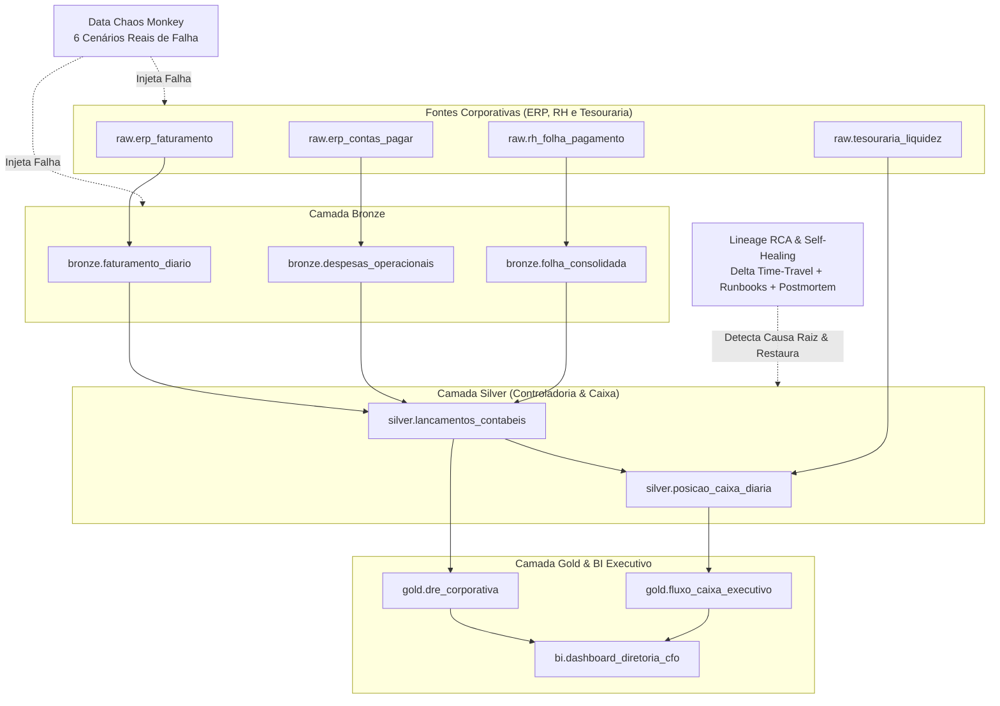

# NovaBank DataOps Command Center — Observability, Chaos Monkey, Lineage RCA & Self-Healing

Plataforma de **Sustentação de Ambientes de Dados, Investigação e Correção Automatizada de Incidentes, Orquestração e Governança por Contratos (ODCS)** construída para os pipelines corporativos e financeiros do **NovaBank**.

---

## Arquitetura e Grafo de Linhagem Corporativa



---

## Destaques Técnicos (Foco em Sustentação, Incidentes e Processos Corporativos)

1. **Malha de 12 Datasets Corporativos (`src/dataops_command_center/corporate_topology.py`)**:
   - Modela os processos corporativos baseados em dados do banco: Faturamento ERP, Contas a Pagar, Folha de Pagamento, Liquidez da Tesouraria, Lançamentos Contábeis, **DRE Corporativa (EBITDA / Lucro Líquido)**, Fluxo de Caixa Executivo e Dashboard do CFO.
2. **Data Contracts no Padrão ODCS & CI/CD Gate**:
   - Cada dataset possui contrato formal com schema esperado, SLA de *freshness* em minutos, faixa de volume e limite de nulos.
   - O endpoint `POST /api/v1/contracts/check-pr` barra *Pull Requests* com *Breaking Changes* (remoção de coluna ou alteração incompatível de tipo) e lista todos os dashboards executivos no **Blast Radius**.
3. **Data Chaos Monkey (`src/dataops_command_center/chaos_and_rca.py`)**:
   - Injeta 6 cenários reais de incidentes de produção:
     - `CENTS_TO_REAIS_SCALE_BUG`: valores em centavos gravados sem divisão por 100 (100x a média histórica).
     - `SCHEMA_COLUMN_RENAME`: coluna `valor_liquido` renomeada silenciosamente para `vlr_liq_v2`.
     - `NULL_SPIKE_EXPLOSION`: explosão de 48,5% de nulos em `centro_custo`.
     - `DUPLICATE_BATCH_LOAD`: carga duplicada (2,4x o volume normal) na folha salarial.
     - `STALE_DATA_SLA_BREACH`: atraso de 240 minutos na posição de liquidez da tesouraria.
     - `VOLUME_DROP_API_OUTAGE`: queda abrupta de 90% no volume diário de faturamento.
4. **Root Cause Analysis (RCA) por Travessia Topológica na Linhagem**:
   - Quando um problema em `raw.erp_faturamento` contamina em cascata `bronze.faturamento_diario`, `silver.lancamentos_contabeis`, `gold.dre_corporativa` e `bi.dashboard_diretoria_cfo`, o algoritmo caminha a montante no grafo de linhagem e isola exatamente o nó raiz (`raw.erp_faturamento`).
5. **Auto-Remediação (Self-Healing Runbooks) & Postmortem Automático**:
   - Executa rollback via *Delta Lake Time-Travel*, normalização de escala, deduplicação e *backfill* dos nós downstream, gerando um **Postmortem em Markdown** e atualizando os KPIs de confiabilidade (**MTTD**, **MTTR**, **Data Health Score** e **SLA Compliance**).

---

## Como Executar e Testar

```bash
pip install -e ".[dev]" fastapi uvicorn httpx
PYTHONPATH=src pytest -v
```

### Subir o Command Center e o Dashboard
```bash
PYTHONPATH=src uvicorn dataops_command_center.api.app:app --reload --port 8000
```
- **Dashboard DataOps**: `http://localhost:8000/dashboard`
- **Swagger OpenAPI**: `http://localhost:8000/docs`
- **Injetar Falha (Chaos Monkey)**: `POST /api/v1/chaos/inject`
- **Auto-Remediar Incidente (Self-Healing)**: `POST /api/v1/incidents/{incident_id}/remediate`
- **Validar Breaking Change em PR**: `POST /api/v1/contracts/check-pr`
